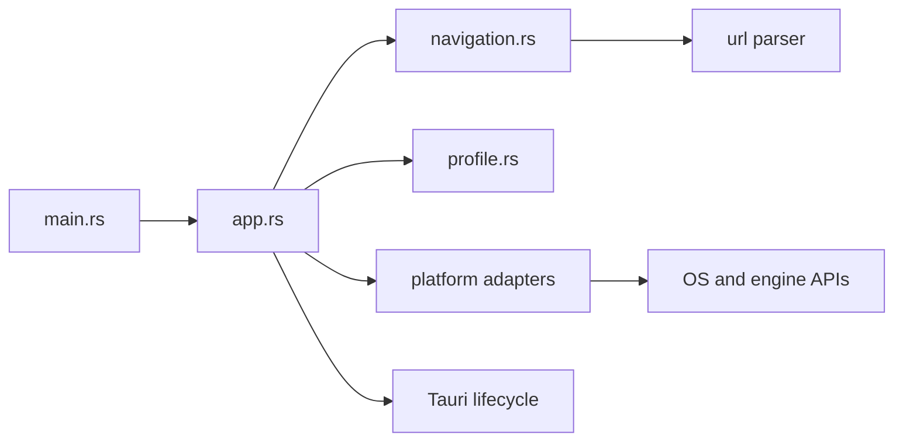

# Architecture

Discard is a single Rust binary crate hosting the official Discord website in
one Tauri window. The v0.2.0 source replaces the old direct Win32 event loop;
it remains a migration candidate until platform acceptance checks are recorded.

The [Tauri migration design](superpowers/specs/2026-10-20-tauri-multiplatform-design.md)
supersedes the Windows-only native module extraction proposed in the
[earlier clean architecture design](superpowers/specs/2026-10-19-clean-architecture-design.md).
That historical proposal does not describe the current module layout.

## Dependency boundaries

The dependency rule applies to real host policy: `navigation.rs` depends only on
the URL parser. It imports no Tauri, OS, COM, filesystem or presentation types.
Discord itself owns accounts, conversations and media; duplicating its domain in
local service/repository layers would add no useful boundary.

| Module or file | Responsibility |
| :--- | :--- |
| `src/main.rs` | Entry point, exit status and final error reporting |
| `src/app.rs` | Tauri setup, one external window, security hooks and exit policy |
| `src/navigation.rs` | Home URL and pure main-frame allowlist |
| `src/updater.rs` | Windows installed-app startup check, native consent and verified Inno handoff |
| `src/profile.rs` | Explicit persistent engine-data locations |
| `src/platform/mod.rs` | Narrow platform configuration/attachment dispatch and native error presentation |
| `src/platform/windows.rs` | Windows identity, DWM appearance and event-driven WebView2 resource policy |
| `src/platform/macos.rs` | WKWebView persistent store and background scheduling configuration |
| `build.rs`, `tauri.conf.json` | Tauri build context, identity, icons and bundle metadata |

There is no empty Linux adapter: Linux uses the supported Tauri engine defaults.
There is no browser trait, workspace of extra crates, frontend tree or global
service registry. Add a module only when it owns a concrete responsibility.

## Lifecycle and ownership

`app::run() -> tauri::Result<()>` configures Tauri and creates `main` from Rust
setup. It loads `https://discord.com/app` directly at 1200×800 logical pixels,
with native decorations, a dark theme and opaque `#1E1F22` background.
`tauri.conf.json` declares no initial windows; it grants no remote capabilities.
No frontend development server or application-authored page script is involved.

`profile::directory(&tauri::AppHandle)` returns the platform's explicit data
location before the window is built. `platform::configure(builder)` applies
builder-only settings, and `platform::attach(&window)` adds native behavior to the
constructed window. Native state stays private to the adapter. Closing `main`
requests application exit explicitly, including on macOS.

Tauri/Wry owns the platform event loop and engine lifecycle. Windows COM access
must remain on the owning UI STA thread through Tauri's native webview callback.
Do not retain borrowed engine pointers, hold an interior borrow across reentrant
native operations, or introduce callback ownership cycles. Optional resource
optimizations must not turn into fatal startup failures.

## Remote-content boundary

- Parse main-frame URLs with `url`: require HTTPS, exact `discord.com`, effective
  port 443, and empty username/password. Prefix matching is insufficient.
- Deny new windows and requested downloads. External-link opening is not implemented.
- Main-frame navigation policy is not a subresource firewall. Discord's CDN and
  engine-managed requests retain normal browser security behavior.
- Configure no application invoke handler, privileged remote capability grants
  to Discord. Updater and dialog plugins are called only from Rust on Windows,
  with no remote capability grants. `withGlobalTauri` is false. Tauri still supplies framework-internal
  scripts and IPC; absence of a global object alone is not isolation proof.
- Keep TLS, origin checks and sandboxing intact. Explicitly return the engine's
  default permission response; this requests WKWebView's origin prompt instead
  of Wry's no-handler media auto-grant. Other engines keep their default decision.
  macOS bundles declare microphone/camera purposes and appropriate capture
  entitlements; declarations do not grant permission or establish media support.

The [compatibility report](validation/tauri-compatibility.md) separates source/ACL
review from runtime probes, login, notifications and capture behavior.

## Persistent data and upgrades

| Platform | Storage contract |
| :--- | :--- |
| Windows | Explicit `%LOCALAPPDATA%\Discard\WebView2`, unchanged from v0.1.0 |
| Linux | Tauri app-local data directory for `com.zvenytoh.discard`, plus `webview` |
| macOS | WKWebView store ID `[213,50,140,206,145,20,70,192,190,120,110,183,97,61,185,142]` |

Keep bundle identifier `com.zvenytoh.discard` stable. Never read, export, clear,
rename or copy cookies during migration. Handle directory/window errors inside
the Tauri setup callback, report them and request exit; returning setup Err would
cause Tauri to panic. Windows presents a dialog, other platforms currently log
to stderr. Never silently create an alternative profile after a failure.
Windows uses the existing location, but sign-in preservation across the upgrade
still needs a user-controlled acceptance check. Profiles are not shared across OSes.

Inno Setup retains AppId `{D5328CCE-9114-46C0-BE78-6EB7613DB98E}` and destination
`%LOCALAPPDATA%\Programs\Discard`. The app and shortcuts use AppUserModelID
`Zvenytoh.Discard`. Uninstall preserves the separate profile. No tray lifecycle or
periodic update polling is included. Since v0.2.1, installed Windows builds check
once at startup through the Rust updater plugin and ask before downloading.
The HTTPS GitHub feed may only point to this repository's versioned installer URL.
The plugin verifies Minisign and the signed version before returning installer bytes.
The host writes a unique temporary executable, launches Inno with the existing
install directory and `/DISCARDUPDATE=1`, then exits. Inno restarts Discard after
a successful silent install. Temporary installer files are left to Windows temp cleanup.
Portable Windows, Linux and macOS builds use manual updates. Signing credentials
are stored in GitHub Actions secrets, never in source; only the public key is embedded.

## Appearance and background policy

The existing coral artwork supplies native executable/bundle, taskbar/Dock,
shortcut and installer icons. Windows 11 uses DWM caption `#1E1F22` and text
`#F2F3F5`; Windows 10 falls back to supported native dark styling. macOS/Linux keep
their native title-bar conventions, so exact caption colors depend on the system.

Windows resource adjustments are event-driven: minimized rendering is hidden,
then restored with the window. Memory target is NORMAL while active or playing
document audio and LOW when otherwise inactive/minimized. Optional interface or
observation failures retain a usable app and conservative NORMAL behavior.
The memory target is a hint, not a private-memory limit. Document-audio silence
cannot establish that no microphone/video call exists.

macOS disables supported WKWebView background throttling to favor ongoing
messages/calls, which can cost background resources. Linux retains engine defaults.
No target gets forced suspension, timer polling, injected keepalives, automatic
reloads, cache purges or GPU-disable flags. Preserve the release LTO, single
codegen unit, stripping and panic-abort settings until measurements justify changes.

Actual CPU, private memory and working set must be measured separately for only
Discard's process tree. Compile success and a smaller working set do not prove
lower allocation, better responsiveness or reliable calls. See the
[performance report](validation/tauri-performance.md).

## Build and release boundary

Runtime remains one crate; packaging belongs to scripts and native CI.
Tauri 2.12.4 and tauri-build 2.7.3 are pinned, with tauri-cli 2.12.3 installed via
Cargo and dependencies resolved in `Cargo.lock`. No Node toolchain is required.

The Desktop workflow targets Windows MSVC x64, Ubuntu 22.04 x64, macOS Intel and
Apple Silicon. Windows retains Inno and its Microsoft-signed WebView2 bootstrapper
verification. Linux produces DEB/AppImage; macOS produces architecture-specific
DMGs with a macOS 14 floor. Branch/PR builds yield artifacts only.

A matching version tag permits one publication job after all required builds.
It computes public asset checksums and excludes unsigned/ad-hoc experimental
macOS artifacts. Signing/notarization secrets belong only in CI; no certificate
is currently configured. Windows binaries remain unsigned. Neither workflow
configuration nor CI compilation establishes engine/media compatibility.

## Rust and validation conventions

Keep application `unsafe` inside `src/platform/`, with local safety comments on
thread affinity, ownership, pointer validity and allocation. Deny unsafe operations
inside unsafe functions without explicit blocks. Favor `Result` and `?`; avoid
panic paths in callbacks. Preserve original error sources until final reporting.

Follow `AGENTS.md`: formatting, Clippy and release compilation for Rust changes;
unit/functional runs only when explicitly requested. Runtime, account, media and
installation cases are independent checks. Record unperformed checks rather than
presenting all desktop targets as validated support.
