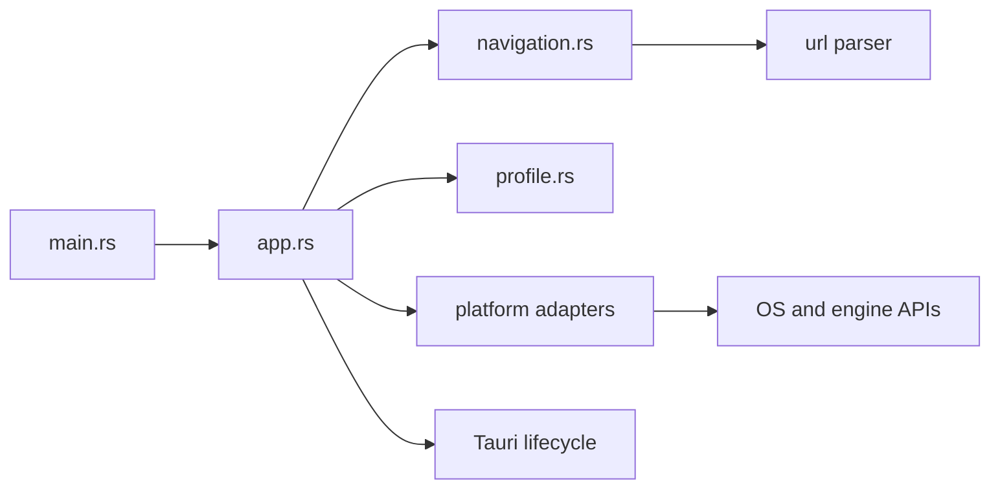

# Architecture

Discard is a single Rust binary crate hosting the official Discord website in
one Tauri window. The v0.2.0 source replaces the old direct Win32 event loop;
it remains a migration candidate until platform acceptance checks are recorded.

The [Tauri migration design](superpowers/specs/2026-10-20-tauri-multiplatform-design.md)
supersedes the Windows-only native module extraction proposed in the
[earlier clean architecture design](superpowers/specs/2026-10-19-clean-architecture-design.md).
That historical proposal does not describe the current module layout.

## Dependency boundaries

The dependency rule applies to real host policy: `navigation.rs` depends only on
the URL parser. It imports no Tauri, OS, COM, filesystem or presentation types.
Discord itself owns accounts, conversations and media; duplicating its domain in
local service/repository layers would add no useful boundary.

| Module or file | Responsibility |
| :--- | :--- |
| `src/main.rs` | Entry point, exit status and final error reporting |
| `src/app.rs` | Tauri setup, one external window, security hooks and exit policy |
| `src/navigation.rs` | Home URL and pure main-frame allowlist |
| `src/updater.rs` | Windows installed-app startup check, native consent and verified Inno handoff |
| `src/tray.rs` | Native tray, mod recovery switches and application-audio selection |
| `src/mods.rs`, `mods.js` | Pinned browser Vencord bootstrap and sanitized activity adapter |
| `src/platform/activity.rs` | Windows foreground-event game matching and process-exit notifications |
| `src/platform/rpc.rs` | Bounded local named-pipe Rich Presence receiver |
| `src/platform/audio.rs`, `audio.js`, `audio-worklet.js` | Experimental native-selected WASAPI audio and bounded binary transport |
| `src/profile.rs` | Explicit persistent engine-data locations |
| `src/platform/mod.rs` | Narrow platform configuration/attachment dispatch and native error presentation |
| `src/platform/titlebar.rs`, `titlebar.js` | Windows frame, accessible native caption buttons and Discord header layout |
| `src/platform/windows.rs` | Windows identity, DWM appearance and event-driven WebView2 resource policy |
| `src/platform/macos.rs` | WKWebView persistent store and background scheduling configuration |
| `build.rs`, `tauri.conf.json` | Tauri build context, identity, icons and bundle metadata |

There is no empty Linux adapter: Linux uses the supported Tauri engine defaults.
There is no browser trait, workspace of extra crates, frontend tree or global
service registry. Add a module only when it owns a concrete responsibility.

## Lifecycle and ownership

`app::run() -> tauri::Result<()>` configures Tauri and creates `main` from Rust
setup. It loads `https://discord.com/app` directly at 1200×800 logical pixels,
with native decorations, a dark theme and opaque `#242429` background.
`tauri.conf.json` declares no initial windows; it grants no remote capabilities.
No frontend development server is involved. Vencord and the native activity/audio adapters now run in the Discord document; this is an explicit extension of the original wrapper-only scope.

`profile::directory(&tauri::AppHandle)` returns the platform's explicit data
location before the window is built. `platform::configure(builder)` applies
builder-only settings, and `platform::attach(&window)` adds native behavior to the
constructed window. Native state stays private to the adapter. Closing `main`
hides it only after a tray icon has been created successfully. The tray owns an
Open/Quit menu; restoring shows, unminimizes and focuses the same window. Quit
and updater handoffs still exit the process directly. Failed tray creation falls
back to close-to-exit, preventing an inaccessible hidden application. On Windows,
hide and restore explicitly refresh the event-driven renderer visibility policy.

Tauri/Wry owns the platform event loop and engine lifecycle. Windows COM access
must remain on the owning UI STA thread through Tauri's native webview callback.
Do not retain borrowed engine pointers, hold an interior borrow across reentrant
native operations, or introduce callback ownership cycles. Optional resource
optimizations must not turn into fatal startup failures.

## Remote-content boundary

- Parse main-frame URLs with `url`: require HTTPS, exact `discord.com`, effective
  port 443, and empty username/password. Prefix matching is insufficient.
- Deny new webviews and requested downloads. A user-initiated support.discord.com
  popup opens only the fixed official support homepage in the system browser.
  Other popups remain denied; the native handler checks the gesture and URL origin.
- Main-frame navigation policy is not a subresource firewall. Discord's CDN and
  engine-managed requests retain normal browser security behavior.
- Configure no application invoke handler, privileged remote capability grants
  to Discord. Updater and dialog plugins are called only from Rust on Windows,
  with no remote capability grants. `withGlobalTauri` is false. Tauri still supplies framework-internal
  scripts and IPC; absence of a global object alone is not isolation proof.
- Keep TLS, origin checks and sandboxing intact. Explicitly return the engine's
  default permission response; this requests WKWebView's origin prompt instead
  of Wry's no-handler media auto-grant. Other engines keep their default decision.
  macOS bundles declare microphone/camera purposes and appropriate capture
  entitlements; declarations do not grant permission or establish media support.

The [compatibility report](validation/tauri-compatibility.md) separates source/ACL
review from runtime probes, login, notifications and capture behavior.

## Persistent data and upgrades

| Platform | Storage contract |
| :--- | :--- |
| Windows | Explicit `%LOCALAPPDATA%\Discard\WebView2`, unchanged from v0.1.0 |
| Linux | Tauri app-local data directory for `com.zvenytoh.discard`, plus `webview` |
| macOS | WKWebView store ID `[213,50,140,206,145,20,70,192,190,120,110,183,97,61,185,142]` |

Keep bundle identifier `com.zvenytoh.discard` stable. Never read, export, clear,
rename or copy cookies during migration. Handle directory/window errors inside
the Tauri setup callback, report them and request exit; returning setup Err would
cause Tauri to panic. Windows presents a dialog, other platforms currently log
to stderr. Never silently create an alternative profile after a failure.
Windows uses the existing location, but sign-in preservation across the upgrade
still needs a user-controlled acceptance check. Profiles are not shared across OSes.

Inno Setup retains AppId `{D5328CCE-9114-46C0-BE78-6EB7613DB98E}` and destination
`%LOCALAPPDATA%\Programs\Discard`. The app and shortcuts use AppUserModelID
`Zvenytoh.Discard`. Uninstall preserves the separate profile. No periodic update polling is included. Since v0.2.1, installed Windows builds check
once at startup through the Rust updater plugin and ask before downloading.
The HTTPS GitHub feed may only point to this repository's versioned installer URL.
The plugin verifies Minisign and the signed version before returning installer bytes.
The host writes a unique temporary executable, launches Inno with the existing
install directory and `/DISCARDUPDATE=1`, then exits. Inno restarts Discard after
a successful silent install. Temporary installer files are left to Windows temp cleanup.
Portable Windows, Linux and macOS builds use manual updates. Signing credentials
are stored in GitHub Actions secrets, never in source; only the public key is embedded.

## Appearance and background policy

The existing coral artwork supplies native executable/bundle, taskbar/Dock,
shortcut and installer icons. Windows retains Discord's actual 32-pixel top bar:
the live title, SVG icons, inbox/help actions and their native page interactions.
Static CSS centers the title and reserves 132 logical pixels at the right for
three native owner-drawn BUTTON controls, each 44 by 32 logical pixels. Buttons
retain Windows input/capture/accessibility semantics, with hover, pressed,
keyboard-focus and red-close feedback. System commands minimize, maximize/restore
and close to tray; restoring focus after maximize returns typing to Discord.

Windows disables Tauri decorations and shadows. The Wry host has a native window
region excluding the controls, updated on resize, so Chromium cannot cover them. WebView2 Settings9 enables CSS app-region dragging before
the first Discord navigation. Windows first creates an empty browser; native
security/drag settings are applied before Navigate(HOME). Discord receives no
native command bridge, web messages or host objects. Other platforms navigate
directly to HOME and keep native decorations.

The one-shot document initialization installs static layout CSS. No observer,
recurring script, synthetic inbox click or additional WebView is used. Native
children are owned/destroyed by their parent; hooks remain on the UI thread and
are removed at destruction. Brushes/pens/DCs are released synchronously. Failed
control setup errors are logged. Discord class-prefix changes may need
CSS updates. Visual fidelity, mixed DPI, zoom, dragging and real input remain
subject to runtime acceptance.

Windows resource adjustments are event-driven: minimized or tray-hidden rendering is hidden,
then restored with the window. Memory target is NORMAL while active or playing
document audio and LOW when otherwise inactive/minimized. Optional interface or
observation failures retain a usable app and conservative NORMAL behavior.
The memory target is a hint, not a private-memory limit. Document-audio silence
cannot establish that no microphone/video call exists.

macOS disables supported WKWebView background throttling to favor ongoing
messages/calls, which can cost background resources. Linux retains engine defaults.
No target gets forced suspension, timer polling, injected keepalives, automatic
reloads, cache purges or GPU-disable flags. Preserve the release LTO, single
codegen unit, stripping and panic-abort settings until measurements justify changes.

Actual CPU, private memory and working set must be measured separately for only
Discard's process tree. Compile success and a smaller working set do not prove
lower allocation, better responsiveness or reliable calls. See the
[performance report](validation/tauri-performance.md).

## Build and release boundary

Runtime remains one crate; packaging belongs to scripts and native CI.
Tauri 2.12.4 and tauri-build 2.7.3 are pinned, with tauri-cli 2.12.3 installed via
Cargo and dependencies resolved in `Cargo.lock`. No Node toolchain is required.

The Desktop release workflow targets Windows MSVC x64 only. Windows retains Inno
and its Microsoft-signed WebView2 bootstrapper verification. Other target modules
remain in source but are not packaged by the current workflow. Branch/PR builds
yield Windows artifacts only.

A matching version tag permits publication after the Windows build succeeds.
It signs the updater installer, creates `latest.json`, and computes public asset
checksums. The updater signing key belongs only in CI. The executable is not
Authenticode-signed. CI compilation does not establish engine/media compatibility.

## Rust and validation conventions

Keep application `unsafe` inside `src/platform/`, with local safety comments on
thread affinity, ownership, pointer validity and allocation. Deny unsafe operations
inside unsafe functions without explicit blocks. Favor `Result` and `?`; avoid
panic paths in callbacks. Preserve original error sources until final reporting.

Follow `AGENTS.md`: formatting, Clippy and release compilation for Rust changes;
unit/functional runs only when explicitly requested. Runtime, account, media and
installation cases are independent checks. Record unperformed checks rather than
presenting all desktop targets as validated support.

The restored Windows window disables native decorations and shadows. A native region reserves the caption controls independently of Chromium rendering order.

## Native integration (v0.3.0)

Vencord initializes at document start only in the main HTTPS discord.com frame.
The official browser bundle and CSS are embedded, with source and hashes pinned
in vendor/vencord. The browser-native stub receives local CSS before initStyles.
Preferences use presence markers in Tauri's app config directory, separately
from the existing WebView2 profile. A tray toggle writes the marker and restarts.

Windows game detection uses one WinEvent/message-wait thread. It opens only the
foreground process for image matching, keeps the game until its process handle
signals exit, and blocks on events while idle. It does not detect never-focused
background games. The filtered catalog excludes launchers and argument-dependent
or ambiguous executable matches. Activity updates go from Rust to the document;
no process paths or process enumeration API are exposed to remote content.

RPC uses discord-ipc-0 through discord-ipc-9 only when no existing owner holds a
name. Local clients are bounded to eight, 64 KiB frames and 60 frames/second per
connection. It accepts handshake, ping and SET_ACTIVITY only; no shell, invite,
filesystem, credential or capture command is implemented. Disconnect and page
reload update the Vencord adapter, with serialized metadata lookups.

Audio is armed by a native tray choice, never by a page-provided PID. Selection
records process creation time and excludes Discard and its ancestors. Only then
is an ephemeral loopback listener created. Handshakes require a fresh 256-bit
path token and exact Discord Origin. The service is read-only: no inbound page
commands start arbitrary native operations. All scripts in the Discord origin
share this trust boundary; the token does not isolate Vencord from Discord code.

A connected share initializes WASAPI process-loopback on a worker MTA, verifies
PID identity and captures 48 kHz stereo float PCM. It blocks on audio, target-exit
and cancellation handles. At most four 1024-frame packets queue for delivery;
the worklet ring is also bounded. PCM travels as binary WebSocket frames, never
video or JSON/base64 sample batches. getDisplayMedia retains the browser's video
and attaches the native audio track. Its stop methods, system-ended events,
navigation and native stop action close the channel and release capture. The
normal path has no local listener or native recording until explicitly armed.

The bridge uses neither Tauri invoke permissions nor WebMessages/host objects.
No CSP is weakened to force the prototype to work. Real-call validation remains
mandatory before treating application audio as production-ready; Windows capture
availability does not prove Discord will publish or receive the attached track.

## Stream investigation (v0.3.1)

The local Vencord adapter wraps the pinned WebScreenShare quality helper and
corrects only its 600000 bit/s target to 6000000, bounded by its existing ceiling.
Upstream vendored assets and their checksums remain unchanged. Capture constraints,
codec selection, network adaptation and Discord's profile labels are not spoofed.

stream.js observes browser peer construction before Vencord/Discord initialize.
It keeps a set of live peers, releases closed peers, and samples sender stats only
when the user requests the native tray diagnostic. It reports capture settings,
actual outbound encoding sizes/FPS and qualityLimitationReason where available;
no recurring stats timer, native capability, network upload or remote-quality
claim is introduced. Cameras and screen shares may both appear in the report.

## Stream stability follow-up (v0.3.2)

The WebScreenShare adapter replaces its unconditional 3840x2160/120 capture and
encoding profile with the selected, allowlisted Vencord resolution/FPS. The
browser still negotiates actual source size and network-limited encoding; this
does not rewrite Discord's profile label or promise the selected quality reaches
viewers. Native audio failure preserves working browser video and reports the
failure instead of stopping all capture tracks. The native diagnostic restores
the window, immediately displays a selectable DOM report and bounds each sender
stats request to three seconds. No background polling was added.

The tray checks WebView2 ExecuteScript completion for a boolean acknowledgment;
a missing diagnostic script now produces a native error instead of a silent no-op.
No WebMessages or remote invocation permissions are enabled for this response.

## Single-instance and tray lifecycle (v0.3.3)

The official single-instance plugin is registered before all other plugins and
before app setup, using the stable application identifier without semver-specific
locks. Duplicate arguments are ignored: reopening only restores the existing
window. The shared restoration action runs on the UI thread, shows/unminimizes,
refreshes renderer visibility and then requests focus; failure to take foreground
focus cannot leave the renderer logically hidden. No second profile is created.

Mod preference changes use request_restart instead of restart on the UI thread,
so ExitRequested/Exit events are delivered. RunEvent::Exit explicitly cancels
activity detection, local RPC and native audio. The plugin also releases its
instance lock on Exit, before Tauri launches the replacement process. Destroyed-window cleanup remains idempotent.
Older binaries that do not implement a single-instance lock must be closed once
when upgrading. Runtime rapid-launch/tray/restart acceptance remains pending.
