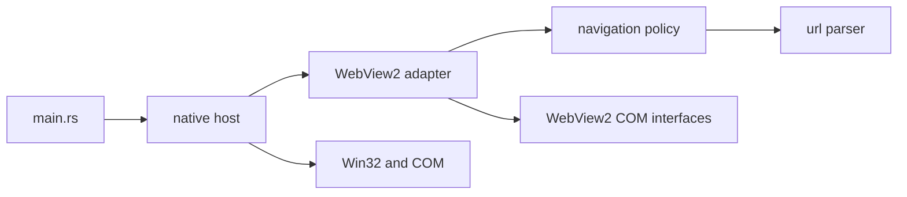

# Architecture

Discard is a native Windows host for the official Discord website. This document
separates the current implementation from the proposed next structure.

## Architectural direction

Apply Clean Architecture's dependency rule at module boundaries: navigation
policy is independent of Windows, WebView2, the filesystem, and presentation.
The native host supplies those effects and applies the policy.

Discord owns accounts, conversations, and media. The local core contains the
host's actual rules; it does not reproduce Discord's server-side domain.
A single binary crate is sufficient for the current scope.

The full proposal, rationale, migration sequence, and acceptance criteria are in
[Clean architecture design](superpowers/specs/2026-10-19-clean-architecture-design.md).
Its proposed extraction has not been applied to the source files yet.

## Current implementation

| File | Current responsibilities |
| :--- | :--- |
| `src/main.rs` | Entry point, exit status, fatal error presentation through the native host |
| `src/navigation.rs` | Home URL and pure HTTPS navigation policy |
| `src/native/mod.rs` | Startup, local profile path, COM guard, state, window creation, message dispatch, shutdown |
| `src/native/webview.rs` | Environment/controller creation, settings, and navigation/download events |



Arrows show source dependencies. The policy never imports the native host.

## Proposed module structure

```text
src/
  main.rs                 Process entry and final reporting
  navigation.rs           Pure host navigation rules
  native/
    mod.rs                Composition, UI state, startup and shutdown coordination
    apartment.rs          COM apartment guard and balancing invariant
    window.rs             Window creation, window procedure and Win32 presentation
    webview.rs            WebView2 controller, configuration and callbacks
```

`apartment.rs` and `window.rs` are proposed extractions. The native modules remain
private and collaborate through narrowly scoped `pub(super)` methods. Platform
composition stays inside `native/` so FFI remains localized. A separate
application layer becomes useful only when platform-independent workflows emerge.

## Ownership and threading

The UI thread owns the window and COM interfaces. COM initialization is balanced
by a guard after native state and controller references have been released.
Microsoft requires WebView2 operations and callbacks to use the owning UI STA
thread with a working message pump.
[WebView2 threading model](https://learn.microsoft.com/en-us/microsoft-edge/webview2/concepts/threading-model).

Use ordinary ownership first. `Rc` is appropriate for this thread's callback
coordination; `RefCell` is limited to fields that actually need interior mutation.
Clone a COM reference or take an owned value, end the borrow, then call native
code. No `RefCell` guard may remain live across a potentially reentrant FFI call.
Rust checks these borrows at runtime, and violations panic.
[Rust Book: interior mutability](https://doc.rust-lang.org/book/ch15-05-interior-mutability.html).

The private thread-local slot connects Win32/COM callbacks to current UI state.
It must not become a registry used by policy or future background workers.
Keep callbacks free of strong ownership cycles. Future workers may return owned
plain data through a bounded channel and a posted message; COM interfaces and
borrowed native pointers stay on the STA.

## Startup and shutdown

Startup resolves the existing profile location, initializes COM, creates the
window/state, starts WebView2 asynchronously, and pumps messages with
`GetMessageW`. A blocking message-pump wait is idle waiting, not polling or a
synchronous wait for a WebView2 completion.

On window destruction, remove callback-visible state before taking and closing
the controller. Post the quit message, release remaining references, and finally
uninitialize COM. A late controller completion must close its received controller
instead of attaching it to a destroyed window. Explicit controller closure is
part of the native boundary.
[Controller Close](https://learn.microsoft.com/en-us/microsoft-edge/webview2/reference/win32/icorewebview2controller#close).

Errors from asynchronous callbacks are stored and signaled to the message loop;
user-facing modal UI occurs after the callback has returned. Ordinary startup
errors return to the entry point. Cleanup paths must preserve the original
failure and never restart the browser automatically.

## Trust boundaries

- Main-frame URLs must use HTTPS, the exact host `discord.com`, port 443, and no
  embedded username/password. Parse with `url`; do not compare URL prefixes.
- WebView2 manages site resources and subframes. Main-frame filtering is not a
  network firewall and must not be described as one.
- Pop-ups and downloads are currently canceled. External-link support requires
  a separate user-initiated, validated policy before being implemented.
- Host objects and web messages are disabled. No page scripts are injected.
- Site permissions retain WebView2's defaults; camera/microphone behavior remains
  unvalidated. Future permission handling must check origin and user intent.
- User data stays in `%LOCALAPPDATA%\Discard\WebView2`. Never rename, clear,
  export, or log account/session data as part of an architecture change.

## Rust conventions and extension rules

Keep `unsafe` within `native/`, with local safety comments describing ownership,
thread affinity, pointer validity, and allocator requirements. Keep native error
sources until presentation when distinct failure handling is introduced. Use
`Result` and `?` for recoverable operations; avoid `unwrap`, `expect`, or deliberate
panics in the callback path. Keep `unsafe_op_in_unsafe_fn` denied.

Add a module when a responsibility has a real owner. Add a trait when a concrete
substitution or testing boundary needs one, and another crate when independent
reuse or a stronger compile-time boundary justifies it. A future tray adapter
belongs with Win32; a future update policy must stay separate from download and
installation effects.

Validation follows `AGENTS.md`: formatting, Clippy, and release compilation for
Rust changes; unit/functional tests only on explicit request. The design document
lists the runtime cases needed before claiming lifecycle or media correctness.
