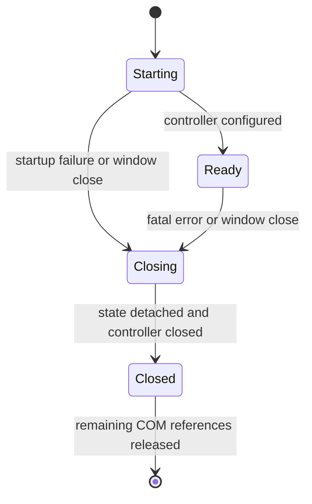

# Discard: clean architecture design

Date: 2026-10-19
Status: Proposed design; source refactoring is not implemented.

## Intent

Keep Discard a focused Rust/Win32/WebView2 client while making ownership, safety,
and responsibility boundaries explicit. This design addresses the existing host,
not a new messaging service. The English README and visual identity are retained.

## Goals and constraints

- Preserve current navigation behavior, session path, platform and dependencies.
- Separate pure policy from native effects and separate native responsibilities.
- Make startup, asynchronous completion, errors and shutdown reviewable.
- Keep the UI responsive without polling or an added asynchronous runtime.
- Prefer standard Rust ownership and restricted visibility over abstraction layers.
- Keep user data and Windows/WebView2 security behavior intact.
- Respect the project's explicit-test-only rule and ban on unsolicited subagents.

The one-crate module structure below is a design recommendation, not a previously
approved user decision. New features, dependencies, a backend, and a cross-platform
rewrite are outside this change.

## Assessment of the existing code

The current `navigation.rs` is a pure function over URLs, already isolated from
Win32. `webview.rs` applies that rule at the browser boundary. These are useful
Clean Architecture boundaries and should be preserved.

`native/mod.rs` currently owns both application coordination and the full window
procedure. Its COM guard has a distinct balancing invariant. Extracting window
handling and the apartment guard gives these responsibilities clear homes while
retaining the existing integration model. File count or line count alone is not
the reason for an extraction.

The current host has little platform-independent application behavior beyond
navigation. There is no reason to model Discord messages, accounts or channels as
local domain entities. A host architecture is not an implementation of Discord.

## Decisions

### 1. Keep a single binary crate with a pure policy module

`navigation.rs` owns the home URL and navigation decision. It accepts borrowed
input and returns a plain result without accessing the environment or making
native calls. The `url` dependency is justified by correct URL parsing.

Native adapters depend on this policy. The policy does not import adapters or
receive `HWND`, COM interfaces, callbacks, `RefCell`, or global state. That is the
dependency rule that matters in the current scope.

### 2. Make native responsibilities explicit

| Module | Owns | Must not own |
| :--- | :--- | :--- |
| `main.rs` | Process entry, exit status and final error handling | Native callbacks and shared UI state |
| `navigation.rs` | Allowed host/scheme/port and home URL | Filesystem, COM, window behavior |
| `native/mod.rs` | Composition, current UI state, startup/shutdown coordination | URL policy implementation |
| `native/apartment.rs` | Successful COM initialization and matching uninitialization | Browser configuration or window dispatch |
| `native/window.rs` | Window creation, message procedure, DPI/size/move handling, dialogs | Authentication or navigation decisions |
| `native/webview.rs` | Browser/controller creation, settings, event adaptation, controller operations | Session deletion or external process launching |

Keep profile-path resolution in the native startup boundary until persistence
actually warrants a separate module. Retain `%LOCALAPPDATA%\Discard\WebView2`.
Move code by responsibility without changing behavior in the same patch.

### 3. Keep one native owner on the STA

`App` remains private to the native module. It holds the window handle, optional
controller and pending error. Use fields with interior mutability rather than
putting the entire application inside one mutable borrow.

The thread-local callback lookup remains an internal adapter detail. All borrows
end before a Win32/COM call. Callbacks obtain a fresh current-state reference;
they do not capture strong references that form controller/handler ownership
cycles. No `Arc<Mutex<App>>` or `unsafe impl Send/Sync` is introduced.

The COM guard is created before COM-owning state and dropped after it. Each owned
native resource has one documented cleanup owner. Shared handles returned by
Windows must not be released as if independently owned. Closing a controller is
explicit; final error presentation must not depend on a dead window handle.

### 4. Preserve asynchronous lifecycle invariants

This is the lifecycle contract, not a requirement to add an enum immediately.
The current optional controller and callback lookup represent a single start and
shutdown. Add a generation identifier only when restart/recreation is actually
implemented, and reject completions from older generations then.

Late creation after close must close the received controller. Partial
configuration must use the same cleanup path as normal closure. Shutdown must
not clear the profile or kill shared browser processes. Error notification must
remain bounded if several callbacks fail; preserve the first actionable failure
rather than replacing it with a cleanup error.

### 5. Keep errors useful and FFI narrow

Use `Result` for fallible operations. While the current public exit behavior is
only success/failure, a large error taxonomy is unnecessary. When the extraction
needs distinct startup/recovery handling, use a small native error enum that
retains `std::io::Error` or `windows::core::Error` as its source and attaches the
operation name. Format it at the presentation boundary, not at every call site.

No additional error-handling dependency is required. Each ignored cleanup error
must be justified as best-effort cleanup without losing the primary failure.
Do not ignore a failed validation, configuration or navigation-policy operation.

Scope `unsafe` to the smallest useful native boundary and document the invariant
that makes it safe. Rust callbacks must not panic across FFI: no unchecked
indexing of foreign inputs, `unwrap`, `expect`, or borrows spanning reentrant
calls. Do not use `catch_unwind` as a substitute for correct ownership.

### 6. Grow interfaces only when behavior needs them

Use concrete adapters and plain functions today. A trait becomes useful when a
real application workflow must depend on a replaceable effect, such as deciding
whether a validated user-initiated external link can be opened. Such a trait
belongs next to that workflow and must not expose Win32 or COM types.

An `application` module can be introduced with the first such workflow. Separate
crates can follow independent reuse or enforcement needs. A dependency-injection
container, generic event bus, repositories for web pages, and empty architectural
layers do not solve a current requirement.

## Migration sequence

1. Establish a clean baseline with formatting, Clippy and a release build.
2. Extract the existing apartment guard to `native/apartment.rs`; retain its
   initialization/drop order and visibility.
3. Extract window creation/presentation/dispatch to `native/window.rs`. Keep
   composition and state in `native/mod.rs`, and WebView2 details in its adapter.
4. Review every caller and error path. Do not combine the move with changes to
   navigation policy, media behavior, dependencies or profile data.
5. Update the README's file map and mark the implemented proposal in the canonical
   architecture document. Run the focused static checks and release build again.

This is a design sequence, not an implementation plan already approved or executed.

## Acceptance and validation

Before the refactor is considered structurally complete:

- Policy has no native imports, filesystem access or side effects.
- FFI and platform state remain inside `native/`; visibility stays minimal.
- Each controller and apartment has a clear cleanup owner on every exit path.
- No `RefCell` guard spans a potentially reentrant native call.
- The profile path, allowlist, disabled bridge, blocked downloads/pop-ups, and
  existing dependency set are unchanged.
- `cargo fmt --all -- --check`, `cargo clippy --locked --all-targets -- -D warnings`,
  and `cargo build --release --locked` succeed. Check MSVC in Windows CI; record
  the actual toolchain used locally.

When the user explicitly requests tests, prioritize pure policy cases (deceptive
hosts, credentials, ports and malformed URLs) and lifecycle failure scenarios.
Do not add a broad suite that only mirrors module wiring.

Runtime checks, separately authorized, must cover close during environment and
controller creation, late completions, partial configuration failure, missing
runtime/profile access errors, resize/DPI/minimize/restore, normal close, and
session persistence. Voice, camera, sharing and performance require their own
actual checks. Compilation alone validates none of those runtime behaviors.

## Reference material

- [WebView2 threading and callback reentrancy](https://learn.microsoft.com/en-us/microsoft-edge/webview2/concepts/threading-model)
- [WebView2 controller Close](https://learn.microsoft.com/en-us/microsoft-edge/webview2/reference/win32/icorewebview2controller#close)
- [Rust interior mutability and runtime borrowing](https://doc.rust-lang.org/book/ch15-05-interior-mutability.html)
- [Rustonomicon: FFI](https://doc.rust-lang.org/nomicon/ffi.html)
- [Rust API Guidelines checklist](https://rust-lang.github.io/api-guidelines/checklist.html)

These sources document platform/language constraints. The module layout and
extraction choices are project-specific recommendations based on the code review.
